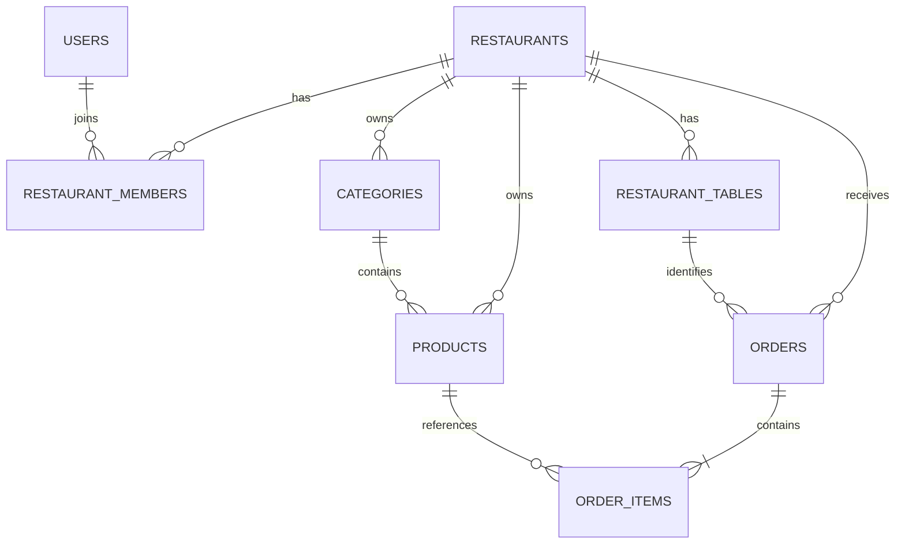
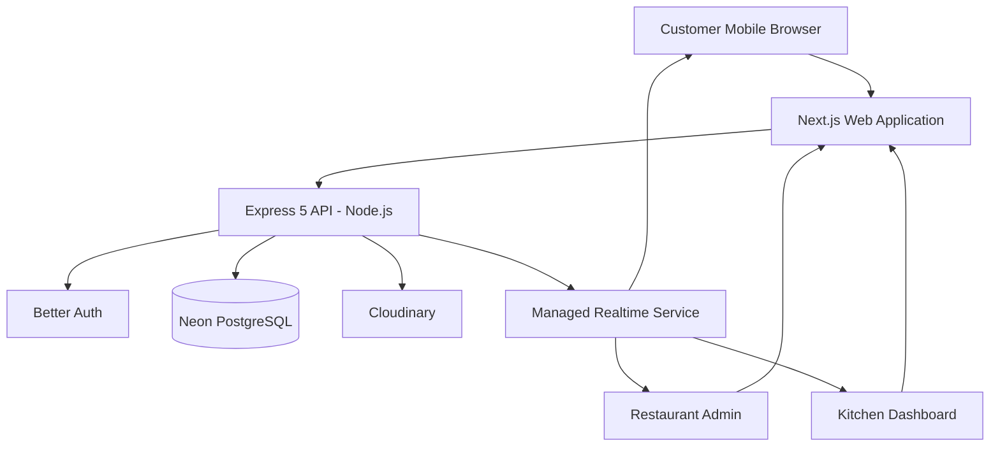

MenuGo V1 -- Detailed Project Plan
Target: Working MVP in 10 days
Development capacity: Approximately 3--4 hours per day (30--40 hours
total)
Product: Multi-tenant QR-based restaurant ordering SaaS
1. Product goal
A customer scans a QR code at a restaurant table, views the restaurant's
digital menu, selects food and places an order. The restaurant receives
the order, processes it in the kitchen and serves the customer.

MenuGo V1 manages digital menus, table-based ordering and the kitchen
workflow. It does not replace the restaurant's existing billing or
POS system.

The same ordering workflow should work for cafés, small restaurants,
family restaurants, food courts and quick-service restaurants.
2. How MenuGo works
1. Customer scans the QR code on the table.
2. MenuGo identifies the restaurant and table.
3. The restaurant's digital menu opens in the customer's mobile
   browser.
4. Customer browses categories and food items.
5. Customer adds items to the cart and adjusts quantities.
6. Customer optionally adds special instructions.
7. Customer submits the order.
8. The backend validates the order and saves it in PostgreSQL.
9. The restaurant dashboard and kitchen screen receive a notification.
10. Staff accept the order and the kitchen prepares it.
11. Kitchen marks the order Ready; staff serve it and mark it Served.
V1 payment model: The customer pays the restaurant using its
existing billing process. MenuGo does not collect online payments in V1.
3. Main interfaces
Build one responsive web application with three role-based interfaces.
They share the same backend and database.
A. Customer interface
Used in a mobile browser after scanning a table QR code.
- Identify restaurant and table from the QR URL.
- Display restaurant name, logo and menu.
- Browse menu categories.
- View food names, descriptions, prices and images.
- Add and remove items from cart.
- Increase or decrease quantities.
- Add special instructions to individual items.
- Review order and submit it.
- See order confirmation and current order status.
Do not require customers to install an app or create an account in V1.
B. Restaurant admin interface
Used by restaurant owners and authorized managers.
- Restaurant profile management.
- Category management.
- Food/product management.
- Image upload.
- Price and availability management.
- Table management.
- QR generation and download.
- Order management.
- Basic order history.
- Staff account and role management.
C. Kitchen interface
Used on a tablet, laptop or desktop by kitchen staff.
- Display incoming orders.
- Play a sound when a new order arrives.
- Show order number and table number.
- Show items, quantities and special instructions.
- Accept or reject orders.
- Move accepted orders to Preparing.
- Mark orders Ready.
- View active and completed orders.
Keep the kitchen interface simple in V1. Do not build separate
preparation stations for beverages, starters and main courses yet.
4. Required modules
Module 1 -- Authentication and restaurant accounts
Purpose: Allow restaurant owners and authorized staff to securely access
MenuGo.

Features: - Restaurant owner registration. - Login and logout. -
Password reset. - Restaurant profile creation. - Staff accounts and role
assignment. - Secure session management.

Suggested roles:

  Role            Permissions
  Owner           Full restaurant access
Manager         Manage menu, tables and orders
Kitchen staff   View kitchen orders and update permitted statuses

Use a separate restaurant_members table. A user should be able to
belong to more than one restaurant in the future.

Use Better Auth for authentication and sessions rather than implementing
password/session handling from scratch.
Module 2 -- Restaurant profile
Purpose: Store information displayed to customers.

Fields: - Restaurant name - Logo - Cover image - Description - Address -
Contact number - Opening hours - Currency - Public menu slug -
Active/inactive status
Module 3 -- Category management
Purpose: Organize the restaurant's menu.

Example categories: - Starters - Soups - Main course - Biryani -
Beverages - Desserts

Admin operations: - Create category. - Edit category. - Delete
category. - Change display order. - Activate/deactivate category.
Module 4 -- Product/food management
Purpose: Allow restaurants to maintain their digital menu.

Suggested product fields:

  Field           Example
  Product name    Chicken Fried Rice
Description     Chicken fried rice
Price           ₹180
Image           Food image
Category        Main course
Availability    Available
Display order   1

Admin operations: - Add food item. - Edit food item. - Delete food
item. - Upload image. - Change price. - Mark unavailable or available. -
Change display order.

Do not erase historical order information when a product is edited or
deleted. Store product name and unit-price snapshots in each order item.
Module 5 -- Table and QR management
Purpose: Identify which restaurant table placed an order.

Admin operations: - Add table. - Edit table. - Delete table. - Generate
QR code. - Download QR code. - Activate/deactivate table.

Each QR should open a unique URL, for example:

https://menugo.in/menu/restaurant-slug?table=secure-token

Use a random, unguessable table token rather than trusting a plain table
number in the URL. Validate the token on the server.

The QR code should remain usable until the restaurant intentionally
rotates or disables it.
Module 6 -- Customer digital menu
Customer journey: 1. Customer scans QR code. 2. MenuGo identifies
restaurant and table. 3. Restaurant logo and menu appear. 4. Customer
browses categories. 5. Customer selects food. 6. Customer adds items to
cart. 7. Customer reviews the order. 8. Customer submits the order.

V1 cart features: - Add item. - Remove item. - Increase/decrease
quantity. - Special instructions per item. - Display subtotal. - Confirm
order.

Keep the mobile menu fast and easy to use. Avoid unnecessary account
creation and extra steps.
Module 7 -- Order management
When a customer submits an order:
1. Backend validates the restaurant and table token.
2. Backend checks that requested products belong to that restaurant.
3. Backend checks product availability.
4. Backend retrieves current prices from the database.
5. Backend calculates the total on the server.
6. Backend creates the order and order items in a database transaction.
7. Backend publishes a realtime notification.
8. Restaurant dashboard displays the new order.
Order statuses:

  Status        Meaning
  NEW         Customer placed the order; awaiting restaurant acceptance
ACCEPTED    Restaurant confirmed the order
PREPARING   Kitchen is preparing the food
READY       Food is ready to serve
SERVED      Food has been served
REJECTED    Restaurant rejected the order
CANCELLED   Order was cancelled by an authorized action

The customer should see confirmation and the latest order status. If
realtime disconnects, the customer and restaurant must be able to
refresh and retrieve the latest state from PostgreSQL.
Module 8 -- Kitchen display system
Kitchen features: - New order sound alert. - New orders displayed
prominently. - Table number and order number. - Item names and
quantities. - Special instructions. - Accept/reject actions. -
Preparing/ready status updates.

Kitchen staff should not need access to restaurant profile, billing or
menu administration.
Module 9 -- Basic dashboard and order history
Give the restaurant owner a simple overview:
- Total orders today.
- Orders waiting for acceptance.
- Orders being prepared.
- Completed orders.
- Basic order history.
- Search by order number or date.
Do not build complex analytics, sales forecasting or inventory
management in V1.
Module 10 -- SaaS platform foundation
Essential multi-tenant requirements: - Multiple independent restaurant
accounts. - Strict restaurant data isolation. - Restaurant-specific
menus, tables and orders. - Role-based access. - Secure image uploads. -
Error logging. - Database backups. - Realtime channels scoped to each
restaurant.

Restaurant A must never be able to access Restaurant B's products,
tables or orders.
5. Restaurant onboarding workflow
1. Sign up: Owner visits MenuGo and creates an account.
2. Create restaurant profile: Enter name, logo, address, contact
   number and opening hours.
3. Create categories: Add categories such as Starters, Main Course,
   Biryani and Beverages.
4. Add food items: Enter names, descriptions, prices and images.
5. Add tables: Create Table 1, Table 2, Table 3, etc.
6. Generate QR codes: Download individual QR codes and print them
   for tables.
7. Add kitchen staff: Create kitchen login credentials and share
   access.
8. Go live: Customers can scan QR codes and start ordering.
The restaurant should eventually be able to complete onboarding without
your assistance. For the first pilot installations, you can help upload
the menu and generate QR codes.
6. Real-world order example
Imagine a customer visiting a restaurant in Coimbatore.
- 10:30 AM: Customer scans the QR code at Table 05.
- 10:32 AM: Customer orders 2 Masala Dosa at ₹90 each and 1 Filter
  Coffee at ₹30. Total: ₹210.
- 10:33 AM: Order #1042 appears on the restaurant dashboard and
  kitchen screen with Table 05.
- 10:34 AM: Kitchen accepts the order; status becomes PREPARING.
- 10:45 AM: Kitchen marks the order READY.
- 10:47 AM: Staff serve the food and mark the order SERVED.
- Customer pays through the restaurant's existing billing process.
7. Database design
Start with these core application tables. Better Auth will also create
and manage its own authentication tables.

  Table                  Purpose
  restaurants          Restaurant information
users                User accounts managed by Better Auth
restaurant_members   User-to-restaurant membership and roles
categories           Menu categories
products             Food items
restaurant_tables    Table details and QR tokens
orders               Main order information
order_items          Items belonging to each order
Relationships

Database rules
1. Every restaurant-owned record must have a restaurant_id.
2. Use UUID primary keys.
3. Store prices in integer paise, not floating-point numbers.
4. Store product name and unit-price snapshots in order_items.
5. Create orders and order items in one database transaction.
6. Calculate prices on the backend.
7. Never trust a restaurant ID supplied by an unauthenticated browser
   request.
8. Use an idempotency key for order submission to prevent duplicate
   orders.
9. Preserve historical orders even if products are edited or deleted.
10. Add indexes for restaurant IDs, order statuses and creation
    timestamps.
11. Consider PostgreSQL Row-Level Security as additional tenant
    isolation protection.
8. Backend API modules
Suggested Express 5 structure:
apps/api/src/
├── modules/
│   ├── auth/
│   ├── restaurants/
│   ├── members/
│   ├── categories/
│   ├── products/
│   ├── tables/
│   ├── orders/
│   └── kitchen/
├── middleware/
│   ├── authenticate.ts
│   ├── authorize.ts
│   ├── validate.ts
│   └── error-handler.ts
├── lib/
│   ├── database.ts
│   ├── cloudinary.ts
│   └── realtime.ts
└── server.ts
Essential application endpoints
  Method           Endpoint                  Purpose
  GET              /restaurants/me         Get restaurant profile
PATCH            /restaurants/me         Update profile
GET / POST       /categories             List/create categories
PATCH / DELETE   /categories/:id         Update/delete category
GET / POST       /products               List/create products
PATCH / DELETE   /products/:id           Update/delete product
GET / POST       /tables                 List/create tables
GET              /public/menu/:slug      Customer menu
POST             /public/orders          Submit customer order
GET              /orders                 Restaurant order list
GET              /orders/:id             Order details
PATCH            /orders/:id/status      Update order status
GET              /public/orders/:token   Customer order tracking

Better Auth should handle its own authentication endpoints and session
lifecycle. The routes above are the application API outline, not a
requirement to reimplement authentication.
Realtime events
Use a managed realtime service initially, such as Ably or Pusher.
- order.created
- order.updated
- product.availability_changed
Realtime should notify clients that something changed. PostgreSQL
remains the source of truth.
9. Exact 10-day development schedule
Assume approximately 3--4 hours per day, giving 30--40 hours total.
  Day                     Module/work             Expected deliverable
  1                       Project foundation: npm Frontend and backend
workspaces, Next.js,    running; database
Express 5, Neon,        connected
Drizzle and GitHub      

  2                       Authentication, tenant  Owner can register and
foundation, restaurant  access their restaurant
profile and roles       

  3                       Category CRUD, product  Restaurant can build
CRUD, Cloudinary image  its digital menu
upload and availability 

  4                       Public restaurant page, QR URL opens the
categories, product     correct restaurant menu
listing, mobile UI and
table identification    

  5                       Cart, quantities,       Customer can place a
special instructions,   real order
server-side pricing and
order creation          

  6                       Order listing, details, Restaurant can receive
status transitions and  and manage orders
realtime notifications  

  7                       Kitchen login,          Kitchen can process
new-order alerts,       incoming orders
accept/reject and
preparation statuses    

  8                       Table management,       Restaurant can generate
secure QR tokens, QR    and print table QR
download and customer   codes
order tracking          

  9                       End-to-end testing,     Complete workflow works
tenant isolation,       reliably
duplicate orders,
mobile UI and failure
cases                   
10                      Deployment, production  First pilot restaurant
database configuration, can use MenuGo
real-device testing and
pilot onboarding
This is an aggressive MVP schedule. If a module takes longer, reduce UI
polish and defer optional features rather than compromising order
reliability, security or database integrity.
10. Features explicitly excluded from V1
  Feature                        Decision
  QR digital menu                V1
Customer cart and ordering     V1
Restaurant admin dashboard     V1
Kitchen order dashboard        V1
Table and QR management        V1
Basic order history            V1
Online payments                Later
POS integration                Later
Inventory management           Later
Waiter mobile application      Later
Customer loyalty and rewards   Later
AI recommendations/chatbot     Later
Advanced analytics             Later
Multiple branches              Later
Subscription automation        Later

Do not create empty screens or placeholder modules for later features
during this sprint.
11. V1 acceptance checklist
Before approaching restaurants, verify:
- [ ] Restaurant A can register and create its menu.
- [ ] Restaurant B can register independently.
- [ ] Restaurant A cannot access Restaurant B's data.
- [ ] QR codes open the correct restaurant and table.
- [ ] Customer can add and remove products from cart.
- [ ] Customer can place an order without creating an account.
- [ ] Backend calculates the correct order total.
- [ ] Restaurant receives the order.
- [ ] Kitchen can accept and update the order.
- [ ] Customer can see the latest order status.
- [ ] Duplicate submissions do not create duplicate orders.
- [ ] Unavailable products cannot be ordered.
- [ ] System works on Android, iPhone and desktop browsers.
- [ ] Restaurant can download and print QR codes.
12. Recommended technical architecture

Recommended stack:

  Layer             Technology
  Frontend          Next.js + React
UI                Tailwind CSS + shadcn/ui
Backend           Node.js + Express 5 + TypeScript
Package manager   npm with npm workspaces
Database          Neon PostgreSQL
ORM               Drizzle ORM
Authentication    Better Auth
Validation        Zod
Image storage     Cloudinary
QR generation     qrcode npm package
Realtime          Ably or Pusher initially
Hosting           Vercel
Version control   GitHub

Start with a modular monolith, not microservices. Keep API instances
stateless. Do not rely on in-memory order storage or in-memory realtime
rooms. Redis, queues and more complex infrastructure can be introduced
when actual usage requires them.
13. Development priority
If you get distracted, return to this order:
1. Restaurant registration and login.
2. Restaurant profile.
3. Category and food management.
4. Customer digital menu.
5. Cart and order placement.
6. Restaurant order dashboard.
7. Kitchen order dashboard.
8. Table and QR management.
9. Realtime order status.
10. Deployment and pilot testing.
14. Final product decision
Do not make MenuGo dependent on a restaurant's existing POS. A
restaurant should be able to start using MenuGo with only:
- A smartphone, tablet or computer.
- An internet connection.
- Printed table QR codes.
This removes a major adoption barrier and makes it easier to approach
the first restaurants.

The first milestone is not 100 restaurants or 100 features. It is one
restaurant using MenuGo for a complete day without needing you to fix
anything manually. Once that works, you have a foundation worth
expanding.