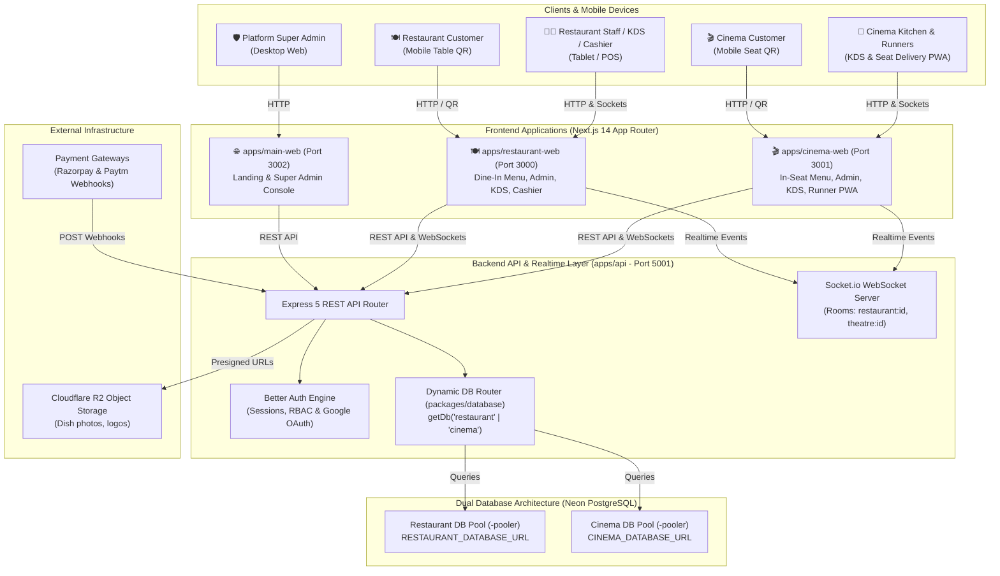
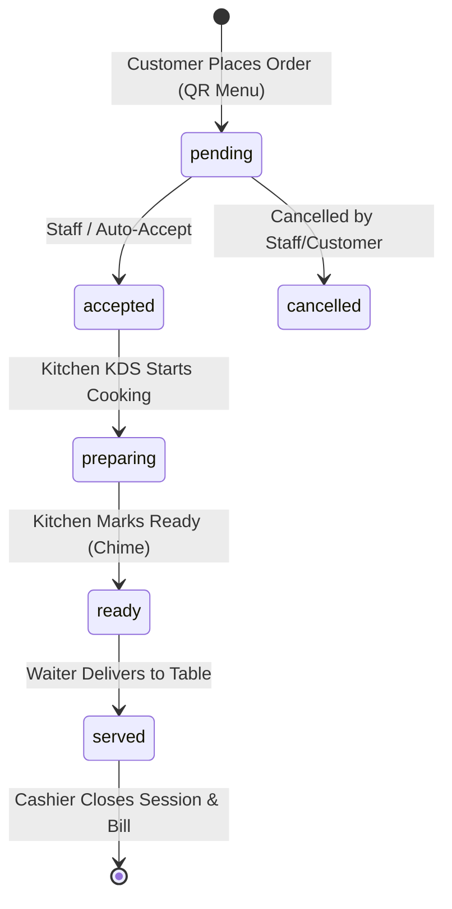
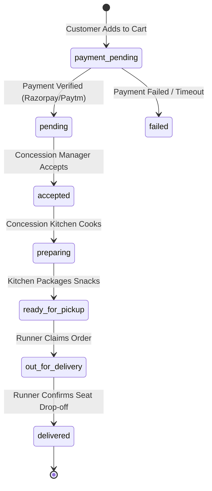

# System Architecture & Technical Deep-Dive — QROS / MenuGo 🏛️

This document describes the high-level system architecture, data models, multi-tenancy design, real-time communications, and security foundations of the QROS platform.

---

## 🏗️ High-Level System Architecture



---

## 📦 Monorepo Structure

QROS is structured as an npm workspaces monorepo:

```
menugo-V1/
├── apps/
│   ├── api/                     # Express 5 REST API & Socket.io WebSocket server (Port 5001)
│   ├── restaurant-web/          # Next.js 14 Dine-in restaurant web application (Port 3000)
│   ├── cinema-web/              # Next.js 14 Cinema / Theatre concessions web application (Port 3001)
│   └── main-web/                # Next.js 14 Platform landing & Super Admin portal (Port 3002)
├── packages/
│   ├── database/                # Drizzle ORM schema, Neon connection pools & migrations
│   └── shared/                  # Shared Zod validation schemas, types, and state machines
├── docs/                        # In-depth architectural & developer documentation
├── scripts/                     # Seed scripts, smoke tests, and maintenance tools
├── e2e/                         # Playwright end-to-end integration test suites
├── package.json                 # Monorepo root workspace configuration
└── README.md                    # Primary repository overview
```

---

## 🗄️ Tri-Database Architecture & Isolation

To support massive scalability, clean multi-tenancy, and centralized platform governance, QROS implements a **Tri-Database Architecture**:

### 1. Connection Pools & Dynamic Routing (`packages/database/src/client.ts`)

Instead of overloading a single database instance, the platform configures three distinct Neon PostgreSQL connection pools:

```typescript
// packages/database/src/client.ts
export const qrosDb = drizzle(qrosPool, { schema });
export const restaurantDb = drizzle(restaurantPool, { schema });
export const cinemaDb = drizzle(cinemaPool, { schema });

export function getDb(type?: 'restaurant' | 'cinema' | 'qros' | 'superadmin' | string) {
  if (type === 'qros' || type === 'superadmin' || type === 'platform') return qrosDb;
  if (type === 'cinema') return cinemaDb;
  return restaurantDb;
}
```

- **👑 Central QROS Master Database (`QROS_DATABASE_URL`)**:
  - Central system of record for **Super Admin operations**.
  - Master registry containing **all restaurants and all cinema theatres** on the platform (`tenantType = 'restaurant' | 'cinema'`).
  - Master catalog of **subscription plans** (`subscription_plans`).
  - Platform-wide **tenant subscriptions** (`tenant_subscriptions`), billing logs, and payment transactions (`subscription_payments`).
  - Super Administrator account provisioning and platform-wide analytics.
- **🍽️ Restaurant Operational Database (`RESTAURANT_DATABASE_URL`)**:
  - Houses restaurant dine-in tables, QR session tokens, digital menus, categories, live orders, order items, KDS, and restaurant staff PINs.
- **🎬 Cinema Operational Database (`CINEMA_DATABASE_URL`)**:
  - Houses multiplexes, screens, auditoriums, row/seat layouts, showtimes, concessions, in-seat orders, and runner dispatch feeds.

> [!NOTE]
> The tri-database synchronization engine (`apps/api/src/lib/qros-sync-service.ts`) automatically harmonizes subscription plans and venue registrations across all three databases on startup and on tenant onboarding.

### 2. Tenant Isolation & Context Scoping
All database queries are strictly scoped to the active tenant ID:
- Restaurant queries require `restaurant_id` validation via `requireRestaurantMember`.
- Cinema queries require `theatre_id` validation via `requireTheatreMember`.
- Super Admin operations query `qrosDb` with validation via `requireSuperAdmin` and `x-super-admin-key`.

Cross-tenant data leakage is prevented at both the middleware layer and the SQL query builder layer.

---

## 🔐 Authentication, Authorization & Roles

QROS features a multi-tiered security model catering to different personas:

### 1. Account Types & Sign-In Flows
- **Restaurant / Cinema Owners & Admins**:
  - Managed by **Better Auth**.
  - Supports Email + Password (argon2/bcrypt hashing) and Google OAuth 2.0.
  - Sessions are tracked via secure HTTP-only cookies (`auth_session`).
- **Floor Staff, Kitchen Cooks & Delivery Runners**:
  - Authenticate via a 4-digit or 6-digit **Staff PIN** (`/api/staff/login-pin` or `/api/cinema/staff/login-pin`).
  - Eliminates the need for floor workers to remember individual passwords or emails.
  - Roles are enforced via permissions on the staff membership record.
- **Super Administrator**:
  - Platform operator dashboard accessed via `apps/main-web/src/app/super-admin`.
  - Gated by `SUPER_ADMIN_EMAILS` and validated against `SUPER_ADMIN_KEY`.

### 2. Role Hierarchy
| Role | Permissions & Access Scope |
|---|---|
| `owner` | Full control over billing, subscriptions, staff, menu, tables/screens, settings. |
| `admin` | Full operational control (menu, staff management, orders, reports), cannot modify owner permissions. |
| `cashier` | Access to Cashier overview, itemized bills, payment settlement, and table session termination. |
| `kitchen` | Dedicated access to live Kitchen Display System (KDS), ticket status progression. |
| `runner` | (Cinema only) Seat delivery PWA, ticket pickup, and in-auditorium delivery confirmation. |
| `staff` | Read-only access to menu, floor assistance alerts, and table status. |

---

## ⚡ Real-Time WebSocket Infrastructure (Socket.io)

Real-time capabilities are powered by a singleton Socket.io server integrated directly into `apps/api`:

### 1. Room Subscription Model
Clients join rooms corresponding to their authenticated tenant:
- Restaurant staff and KDS join: `restaurant:${restaurantId}`
- Cinema staff, KDS, and runners join: `theatre:${theatreId}`
- Individual customers join: `order:${orderId}` for live order progression.

### 2. Core Realtime Events
| Event Name | Source | Destination | Purpose |
|---|---|---|---|
| `order:created` | Customer Checkout | Staff & Kitchen KDS | Emits new order ticket with line items & table info |
| `order:status_updated` | KDS / Staff | Customer & Cashier | Broadcasts status change (`accepted`, `preparing`, `ready`, etc.) |
| `service:requested` | Customer Menu | Floor Staff | Triggers "Call Waiter", "Water Request", or "Bill Request" alerts |
| `service:updated` | Floor Staff | Floor Staff | Updates service request status (`pending` $\to$ `completed`) |
| `cinema:order:created` | Seat Checkout | Cinema KDS | New concession food order placed from an auditorium seat |
| `cinema:order:status_updated` | Kitchen / Runner | Customer & Dispatch | Ticket ready for runner pickup or delivered to seat |

### 3. Mobile Web Audio Handling
Modern mobile browsers (iOS Safari, Android Chrome) block autoplay of audio chimes unless unlocked by user interaction. The KDS and Runner PWAs implement a user activation prompt ("Tap to Enable Kitchen Chimes") which primes the `AudioContext` so that incoming socket tickets play audible chimes in loud kitchen environments.

---

## 🔄 Order Lifecycles & State Machines

### Restaurant Dine-In Order Flow



- **Table Session Concurrency**: When customer Party A scans Table 1's QR code, an active session token is minted. If another customer scans the same table, the system returns `TABLE_OCCUPIED` until the cashier closes the session or settles the bill.

### Cinema Concessions Order Flow



---

## 💳 Payment Gateway Architecture & Security

Cinema seat delivery orders require upfront online payment. QROS supports multi-merchant payment gateways:

1. **Merchant Independence**:
   - Each cinema chain or independent theatre inputs their own Razorpay Key ID/Secret or Paytm Merchant ID in the Cinema Admin Settings.
2. **AES-256-GCM Encryption**:
   - Merchant secrets are encrypted at rest using an AES-256-GCM encryption key (`ENCRYPTION_KEY`). Secrets are never stored in plaintext in the database.
3. **Webhook Verification**:
   - Server-to-Server (S2S) webhooks (`/api/cinema/payments/webhook/:theatreId/:gateway`) verify digital signatures against the decrypted merchant secret before confirming orders.

---

## ☁️ Media Upload Pipeline (Cloudflare R2)

Dish photos, menu graphics, and restaurant logos are stored on **Cloudflare R2** (S3-compatible object storage) without egress fees:

1. **Client Request**: Frontend requests a presigned upload URL from `POST /api/upload/presigned-url`.
2. **Presigned Generation**: API creates an S3 PutObject presigned URL using `@aws-sdk/client-s3` and `@aws-sdk/s3-request-presigner`.
3. **Direct Upload**: Browser uploads the binary image directly to Cloudflare R2, bypassing the API server and saving backend bandwidth.
4. **Public Delivery**: Image is served via Cloudflare CDN (`R2_PUBLIC_URL`).
